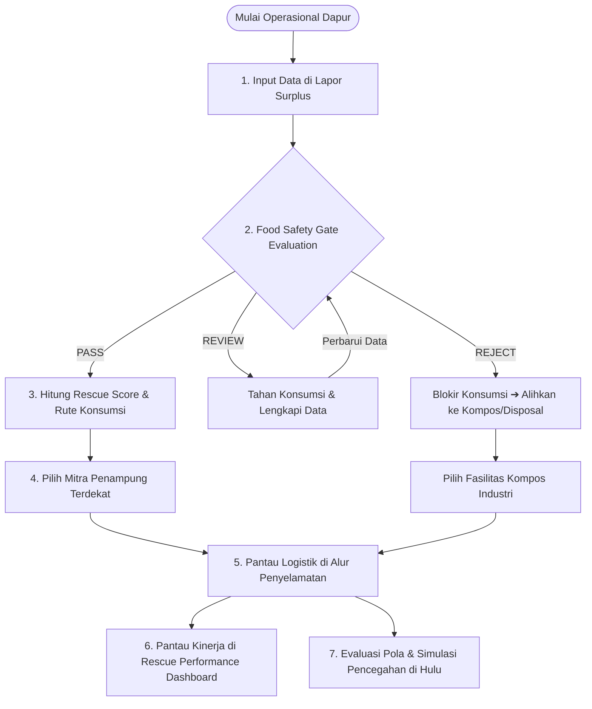

# 🍽️ REPLATE — Give Surplus Food Another Route

<p align="center">
  
  
  
  
  
  
  
</p>

<p align="center">
  <b>🌐 Live Website:</b> <a href="https://replate-omega.vercel.app" target="_blank">https://replate-omega.vercel.app</a><br/>
  <b>📦 GitHub Repository:</b> <a href="https://github.com/rohmatulloh-pixel/replate" target="_blank">https://github.com/rohmatulloh-pixel/replate</a>
</p>

---

## 📖 Tentang REPLATE

> **"Food should move. Not waste."**  
> *(Makanan harus bergerak, bukan terbuang.)*

**REPLATE** adalah platform manajemen dan penyelamatan surplus pangan cerdas (*Intelligent Food Surplus Routing & Upstream Prevention Platform*). Platform ini dirancang untuk menjembatani bisnis F&B, hotel, katering, restoran, dan penyelenggara acara dengan ekosistem penyelamatan makanan (bank makanan, panti asuhan, dapur sosial, dan pengolah kompos).

REPLATE menerapkan arsitektur bertahap dengan gerbang pemeriksaan awal **Food Safety Gate** yang mengutamakan keselamatan publik sebelum sistem memberikan rekomendasi konsumsi manusia:

```text
REPORT SURPLUS ➔ FOOD SAFETY GATE ➔ RESCUE SCORE ➔ ROUTE ENGINE ➔ MATCHING ENGINE ➔ FOOD JOURNEY ➔ RESCUE PERFORMANCE
```

---

## ⚠️ Permasalahan yang Dihadapi (Problem Statement)

1. **Paradoks Sampah Pangan Indonesia:**
   * Indonesia membuang **23–48 juta ton makanan per tahun** (Kajian Bappenas). Kerugian ekonomi mencapai lebih dari Rp 200–550 triliun per tahun.
   * Di saat yang sama, jutaan masyarakat masih menghadapi kerentanan gizi dan stunting.
2. **Keterbatasan Waktu & Kebingungan Dapur (*Shelf-Life Crisis*):**
   * Makanan siap santap memiliki masa simpan kritis (beberapa jam sebelum basi).
   * Restoran dan katering sering kali tidak memiliki saluran distribusi cepat, sehingga opsi tercepat yang diambil adalah langsung membuangnya ke TPA.
3. **Risiko Keamanan Pangan & Penyakit Bawaan Makanan (*Foodborne Illness*):**
   * Penyelamatan makanan tanpa verifikasi suhu dan riwayat penyimpanan berisiko memicu kontaminasi bakteri berbahaya (*Salmonella, E. coli, Bacillus cereus*).
   * Rescue Score yang tinggi untuk porsi besar tidak boleh mengesampingkan parameter keamanan pangan.
4. **Krisis Iklim dari Gas Metana ($CH_4$):**
   * Makanan organik yang membusuk di TPA tanpa oksigen menghasilkan gas metana yang memiliki potensi pemanasan global puluhan kali lipat lebih agresif daripada $CO_2$.
5. **Tanpa Evaluasi Pencegahan (*Over-Ordering* Berulang):**
   * Dapur komersial sering mengalami kelebihan porsi yang sama berulang kali karena tidak memiliki data analitik untuk memperbaiki perencanaan belanja bahan baku di hulu (*upstream*).

---

## 🛡️ Inovasi: Food Safety Gate

**Food Safety Gate** adalah gerbang pemeriksaan deterministik berbasis aturan yang memeriksa kelayakan surplus sebelum rekomendasi konsumsi manusia dibuka.

> **PENTING:** Food Safety Gate BUKAN sertifikasi keamanan pangan resmi dan bukan pengganti inspeksi fisik oleh petugas yang berwenang. Status **PASS** didefinisikan secara transparan sebagai *"Lolos pemeriksaan awal berdasarkan informasi yang dimasukkan pengguna"*.

### Parameter Pemeriksaan (6 Parameter Inti):
1. **Jenis Pangan:** Aturan penyimpanan dan ambang batas disesuaikan spesifik per kategori (makanan matang, bakery, produk susu, daging/ikan, produk segar, dan makanan kemasan).
2. **Kondisi Fisik Sensoris:** Memeriksa ada tidaknya perubahan warna, bau abnormal, lendir, atau jamur. Tanda kerusakan jelas langsung memicu `REJECT`.
3. **Riwayat Penyimpanan & Suhu Holding:** Memverifikasi pengendalian suhu (*hot holding* >60°C atau *cold chain* <4°C) untuk mencegah proliferasi bakteri di *Temperature Danger Zone* (5°C–60°C).
4. **Waktu Penyiapan & Kedaluwarsa:** Validasi tanggal dan waktu tidak logis. Produk melewati tanggal kedaluwarsa ('Baik Digunakan Sebelum') otomatis memicu `REJECT`.
5. **Integritas Kemasan (Prinsip Cek KLIK BPOM):** Memeriksa keutuhan wadah, segel, dan kaleng kembung/penyok parah.
6. **Higiene Penanganan & Pemisahan:** Memverifikasi pemisahan dari bahan mentah untuk mencegah kontaminasi silang.

### Sistem Status:
* 🟢 **PASS:** Lolos pemeriksaan awal. Memenuhi syarat untuk dilanjutkan ke penilaian prioritas Rescue Score dan rute konsumsi manusia.
* 🟡 **REVIEW:** Data penting belum lengkap atau riwayat suhu tidak diketahui. Rekomendasi penyaluran konsumsi **DITAHAN sementara**.
* 🔴 **REJECT:** Melanggar standar keamanan pangan dasar. Rekomendasi redistribusi konsumsi **DIBLOKIR permanen**. Dialihkan terpisah ke pengomposan biologis atau pembuangan aman.

### Rujukan Sumber Regulasi Resmi:
1. **World Health Organization (WHO):** [Food Safety Fact Sheet](https://www.who.int/news-room/fact-sheets/detail/food-safety) & [Public Health Advice on Food Safety](https://www.who.int/news-room/fact-sheets/item/public-health-advice-on-food-safety-during-summer).
2. **Kementerian Kesehatan Republik Indonesia:** [Portal Kemkes](https://kemkes.go.id/) & [JDIH Kemenkes](https://jdih.kemkes.go.id/) (Permenkes Higiene Sanitasi Jasaboga).
3. **Badan Pengawas Obat dan Makanan (BPOM RI):** [Keamanan Pangan & Pedoman Cek KLIK](https://www.pom.go.id/berita/keamanan-pangan-jajanan-anak-sekolah-%28pjas%29).

---

## ✨ Fitur-Fitur Utama Platform

### 1. 🏠 Beranda Interaktif (*Home*)
* Ringkasan visi, indikator cepat, alur 7 tahap penyelamatan, dan tombol aksi cepat.

### 2. 📝 Lapor Surplus Cepat (*Report Surplus*)
* Formulir input dengan 6 parameter Food Safety Gate, preset instan (Nasi, Sayur, Roti), dan validasi waktu penyiapan.

### 3. ⚖️ Penilaian Cerdas & Algoritma Rescue Score (*Assessment*)
* **Food Safety Gate Card Teratas:** Status visual, ringkasan hasil, rincian 6 parameter, dan tombol edit parameter di tempat.
* **Rescue Score (0–100):** Mesin penilaian deterministik (Kondisi 30%, Urgensi 25%, Volume 15%, Kemudahan Distribusi 15%, Kecocokan Tujuan 15%). Jika status `REVIEW` atau `REJECT`, skor konsumsi ditahan/dibatalkan.
* **Rute Hierarki Pangan:**
  * 🟢 **Distribusi Langsung:** Penyaluran makanan siap santap ke bank makanan/panti.
  * 🟡 **Pengolahan Kembali (*Repurpose*):** Transformasi bahan baku menjadi produk kuliner bernilai tambah.
  * 🟠 **Pengalihan Organik (Kompos / Bio-Energi):** Khusus sisa organik rusak untuk pencegahan gas metana.
  * 🔴 **Pembuangan Terkendali (*Safe Disposal*):** Penanganan limbah berkemasan berbahaya/terkontaminasi.

### 4. 🤝 Pencocokan Mitra Cerdas (*Smart Matching Engine*)
* Memasangkan surplus dengan mitra terdekat berdasarkan rute, kapasitas penerimaan, dan jam operasional. Mitra konsumsi manusia otomatis disaring jika surplus berstatus `REJECT`.

### 5. 🚚 Alur Pelacakan Logistik (*Journey & Custody Tracking*)
* Memantau status penanganan makanan surplus secara bertahap dari *Reported*, *Assessed*, *Matched*, *In Transit*, hingga *Received & Rescued*. Menampilkan badge Food Safety Gate pada setiap catatan.

### 6. 📊 Dashboard Kinerja Penyelamatan (*Rescue Performance*)
* Menggantikan metrik dekoratif dengan dashboard kinerja operasional nyata berbasis rantai pasok:
  * **Empat KPI Inti:**
    1. **Total Surplus Dilaporkan (kg):** Total volume surplus valid yang dicatat dalam sistem.
    2. **Pangan Berhasil Disalurkan (kg):** Berat dari transaksi yang telah dikonfirmasi diterima secara fisik (`RECEIVED`), memprioritaskan berat aktual penerimaan.
    3. **Rata-rata Waktu Penyelamatan (Jam/Menit):** Durasi nyata dari laporan dibuat hingga serah terima fisik (tanpa angka acak/otomatis, menampilkan *"Belum ada data"* jika belum ada transaksi selesai).
    4. **Tingkat Keberhasilan (%):** `(Transaksi Selesai ÷ Transaksi Jatuh Tempo) × 100%`, aman dari pembagian dengan nol.
  * **Operational Status Pipeline:** Visualisasi 6 tahap alur penyelamatan dan identifikasi hambatan operasional nyata (antrean tertahan >2 jam, review keamanan, pembatalan).
  * **Supply Chain Performance Funnel:** Analisis tingkat konversi bertahap dan daftar transaksi yang paling lama menunggu tindakan.
  * **Surplus Value Exchange:** Valuasi ekonomi transparan yang memisahkan Nilai Penawaran, Nilai Transaksi Selesai (komersial), dan Penghematan Belanja Komunitas Penerima (donasi sosial).
  * **Estimasi Dampak Lingkungan (Sekunder):** Bagian opsional/terbuka-tutup dengan faktor emisi US EPA WARM (2.1 kg CO₂e/kg) dan FAO (250 L air/kg), dihitung murni dari transaksi fisik yang telah berstatus DITERIMA.

### 7. 💡 Wawasan Operasional & Simulator Pencegahan (*Insights & Simulator*)
* Deteksi pola surplus berulang di dapur, rekomendasi pencegahan otomatis di hulu, dan *Interactive Prevention Simulator* untuk menekan biaya belanja bahan baku.

### 8. 📚 Pusat Edukasi, Metodologi & Sumber (*Learn*)
* Halaman metodologi lengkap yang memisahkan: (1) Prinsip resmi WHO/Kemenkes/BPOM, (2) Aturan operasional prototipe REPLATE, dan (3) Asumsi serta batasan teknis.

---

## 🛠️ Alur Penggunaan (User Workflow)



---

## 📁 Struktur Direktori Proyek

```text
replate/
├── public/                 # Favicon dan aset statis SVG
├── scripts/
│   ├── test-food-safety-gate.js      # Script otomasi pengujian 13 skenario gate
│   └── test-rescue-performance.js   # Script otomasi pengujian 8 skenario analitik kinerja
├── src/
│   ├── assets/             # Ilustrasi & logo
│   ├── components/         # Komponen UI modular
│   │   ├── Button.jsx              # Tombol kustom bervariasi
│   │   ├── EditSafetyModal.jsx     # Modal edit parameter keamanan di Assessment
│   │   ├── EmptyState.jsx          # Tampilan saat data kosong
│   │   ├── ErrorBoundary.jsx       # Penangkal error runtime
│   │   ├── FoodSafetyGateCard.jsx  # Kartu status Food Safety Gate teratas
│   │   ├── Footer.jsx              # Footer gelombang modern
│   │   ├── JourneyTimeline.jsx     # Garis waktu status logistik + safety pill
│   │   ├── MatchCard.jsx           # Kartu rekomendasi mitra + lock state
│   │   ├── Navbar.jsx              # Navigasi melayang + selector bahasa
│   │   ├── PreventionSimulator.jsx # Simulator pencegahan surplus
│   │   ├── ScoreBreakdown.jsx      # Visualisasi rincian skor
│   │   └── StatusBadge.jsx         # Badge status multi-warna
│   ├── data/               # Data benchmark, aturan, dan mitra
│   │   ├── destinations.js         # Daftar mitra penampung terverifikasi
│   │   ├── foods.js                # Kategori pangan & kosakata Food Safety Gate
│   │   ├── learning.js             # 5 modul edukasi rantai pasok
│   │   ├── rules.js                # Aturan pembobotan rute deterministik
│   │   └── sources.js              # Kategori asal operasional
│   ├── engine/             # Mesin logika deterministik
│   │   ├── foodSafetyGate.js       # Gerbang pemeriksaan keamanan pangan awal
│   │   ├── matchingEngine.js       # Algoritma pencocokan mitra
│   │   ├── rescueScore.js          # Kalkulator Rescue Score (0-100)
│   │   └── routeEngine.js          # Penentu rute hierarki pangan
│   ├── pages/              # Halaman utama aplikasi
│   │   ├── Assessment.jsx          # Halaman evaluasi & Food Safety Gate
│   │   ├── Home.jsx                # Halaman beranda interaktif
│   │   ├── Impact.jsx              # Dashboard dampak ESG & emisi karbon
│   │   ├── Insights.jsx            # Wawasan surplus & simulator pencegahan
│   │   ├── Journey.jsx             # Pelacakan alur penyelamatan real-time
│   │   ├── Learn.jsx               # Pusat metodologi, rujukan WHO/BPOM & edukasi
│   │   └── ReportSurplus.jsx       # Formulir pelaporan makanan berlebih
│   ├── utils/              # Modul utilitas
│   │   ├── calculations.js         # Perhitungan dampak & porsi pangan
│   │   ├── formatters.js           # Format mata uang & tanggal
│   │   ├── i18n.js                 # Kamus terjemahan Bahasa Indonesia & Inggris
│   │   └── storage.js              # Manajemen penyimpanan lokal (localStorage)
│   ├── App.jsx             # Root komponen & navigasi routing
│   ├── index.css           # Konfigurasi Tailwind & gaya global
│   └── main.jsx            # Titik masuk render React DOM
├── index.html              # Shell HTML & Google Fonts
├── package.json            # Daftar pustaka & skrip proyek
├── tailwind.config.js      # Konfigurasi palet warna & tipografi
├── vercel.json             # Konfigurasi routing SPA Vercel
└── vite.config.js          # Konfigurasi bundler Vite
```

---

## 🧪 Pengujian Otomatis (*Automated Test Suite*)

REPLATE dilengkapi dengan skrip pengujian untuk memverifikasi seluruh 13 skenario wajib Food Safety Gate:

```bash
# Jalankan test suite verifikasi 13 skenario
node scripts/test-food-safety-gate.js
```

### Ringkasan 13 Skenario Uji:
1. Informasi lengkap & memenuhi standar ➔ `PASS`
2. Riwayat penyimpanan tidak diketahui ➔ `REVIEW`
3. Waktu penyimpanan tidak lengkap / kondisi berubah ➔ `REVIEW`
4. Ditemukan tanda kerusakan atau pembusukan jelas ➔ `REJECT`
5. Produk kedaluwarsa ➔ `REJECT`; Jam di masa depan ➔ `REVIEW`
6. Perubahan data di Assessment langsung memperbarui evaluasi secara dinamis
7. Makanan berstatus `REVIEW` diblokir dari rekomendasi rute konsumsi
8. Makanan berstatus `REJECT` diblokir mutlak dari konsumsi & mitra makanan manusia
9. Makanan berstatus `PASS` menerima Rescue Score & rute konsumsi yang sesuai
10. Rescue Score tinggi tidak dapat mengesampingkan status `REVIEW` atau `REJECT`
11. Metadata hasil evaluasi tersimpan konsisten dan ter-serialize rapi
12. Data `localStorage` lama otomatis bermigrasi konservatif ke `REVIEW`
13. Kemasan kaleng rusak/penyok parah dipetakan ke rute `SAFE_DISPOSAL`

---

## 🚀 Panduan Menjalankan Proyek secara Lokal

### Kebutuhan Sistem
* [Node.js](https://nodejs.org/) versi 18.0.0 atau lebih baru
* npm atau yarn / pnpm

### 1. Kloning Repositori
```bash
git clone https://github.com/rohmatulloh-pixel/replate.git
cd replate
```

### 2. Instalasi Dependensi
```bash
npm install
```

### 3. Jalankan Pengujian
```bash
node scripts/test-food-safety-gate.js
```

### 4. Jalankan Server Pengembangan
```bash
npm run dev
```
Buka peramban dan akses alamat:  
👉 **`http://localhost:5173/`**

### 5. Build untuk Produksi
```bash
npm run build
npm run preview
```

---

## 🛡️ Catatan Keamanan Pangan (*Food Safety Disclaimer*)

> **REPLATE menyediakan sistem pendukung keputusan algoritmik untuk redistribusi dan pencegahan surplus makanan. Platform ini tidak menggantikan inspeksi keamanan pangan langsung di lokasi atau standar sertifikasi higienitas resmi oleh tenaga kesehatan berwenang. Keputusan redistribusi makanan siap santap harus selalu mematuhi panduan dinas kesehatan dan regulasi keamanan pangan yang berlaku.**

---

## 📄 Lisensi
Didistribusikan di bawah lisensi **MIT License**.
Dikembangkan untuk masa depan rantai pasok pangan yang berkelanjutan, aman, dan bebas sampah.
